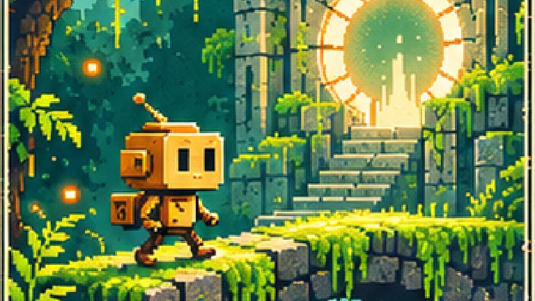

# SAVE SLOT

Six small worlds on one shelf. Pull out a box, open its flap, slide the cartridge into a small retro console — then play one of six complete Canvas2D mini-games.

[Open the preview](https://seoshiro.github.io/save-slot/) · [Beibars' portfolio](https://seoshiro.github.io/)

An independent portfolio concept by **Beibars Ileskhan**, built with AI assistance. All six worlds are playable mini-games, each with a different mechanic, a clear finish and its own session progress.



## Pick a world

| Slot | World         | Inside                                             |
| ---- | ------------- | -------------------------------------------------- |
| 001  | DUSK DELIVERY | A courier's last run through a sunset city         |
| 002  | ORBIT ZERO    | A small ship beneath a broken orbital ring         |
| 003  | MOSS SIGNAL   | A playable forest, three beacons, one stone portal |
| 004  | TIDEBOUND     | A lighthouse, a boat, and the route back to shore  |
| 005  | EMBER VAULT   | A key waiting behind ancient stone doors           |
| 006  | SNOWBYTE      | A cable car crossing a quiet mountain pass         |

## What you can do

- Browse a physical 3D shelf by dragging, selecting a neighbouring box, using arrows, or using the six HTML selection buttons.
- Open the selected box. Its real hinged flap opens before the matching cartridge clears the box and moves over the console slot.
- Insert the cartridge and play the selected world. The return runs the same physical sequence in reverse.
- Keep the selected world when returning. Each cartridge keeps its own position and objectives through a page refresh in the same browser session. EN/RU and collection selection are stored locally.
- Use the light view if WebGL/model loading fails. All six games also run on a flat Canvas screen.

## Six playable cartridges

- **DUSK DELIVERY:** deliver three parcels, avoid moving traffic, and return to the depot.
- **ORBIT ZERO:** collect three energy cells, steer around asteroids and brake to dock.
- **MOSS SIGNAL:** restore three beacons and enter the portal.
- **TIDEBOUND:** cross three tidal channels between waves, using islands as checkpoints, then reach the lighthouse.
- **EMBER VAULT:** find the key, activate two seals, cross timed fire traps, and open the vault.
- **SNOWBYTE:** negotiate a zigzag ice route with momentum and braking, then reach the cable-car station.

The first entry prepares actual artwork, local fonts and GPU resources before revealing the shelf. The approximately three-second cartridge introduction is skippable once preparation is complete; reduced-motion users have no decorative wait. Errors offer retry or a playable light view. Returning from a game never repeats the intro.

## MOSS SIGNAL

Walk through the forest, stand close to each of the three beacons, and activate it once. All three signals open the portal. Reach it to finish.

**Keyboard:** arrows/WASD to move, E to activate, Escape to pause. **Touch:** directional pad, Activate, Pause. A larger game view is available.

The game has actual movement, collision terrain, activation distance, a unique signal counter, pause, completion and a confirmed restart. It is drawn on a 448 × 320 Canvas and shared with the console's screen as a CanvasTexture. It is not a video of gameplay.

## Built around one scene

React + TypeScript + Vite handle the interface and storage. Three.js renders one persistent scene; shared box/cartridge geometry carries six distinct sets of supplied artwork. GSAP animates a continuous progress value for opening, insertion and reverse packing, without rebuilding the renderer. Canvas2D handles the small game; no game engine is installed.

The console began as **one Meshy 7 Ultra generation through Higgsfield**. Blender cleanup corrected the generated top tray into an actual cartridge aperture, shortened the excessive body depth, separated the control, cleaned materials and reduced the mesh. The screen and indicator are independent runtime elements.

- [Browser GLB](public/media/console.glb)
- [Model inspection](art/source/console-report.json)
- [Generation and expense ledger](docs/CREDITS.md)

The original Meshy GLB and editable Blender source are retained in the delivered source-asset archive. They are not required to run the preview. The Blender-cleaned browser model is 1,003,836 bytes and is published. Its versioned asset URL was verified against both the local SHA-256 and the confirmed Git blob; see docs/QA.md.

The main portfolio, NOCT and SIDE A are unchanged. No backend, tracking, payments, account system or external AI calls run in the published site.

## Run locally

Requires Node.js 24.

```sh
npm ci --ignore-scripts
npm run dev
npm test
npm run build
```

The relative Vite base also works under a nested path. The Pages workflow sets `/save-slot/` explicitly. Hash links select a world directly, for example `#moss-signal`.

Artwork is supplied with this concept. `node scripts/prepare-art.mjs` prepares the cover/world WebP assets from the retained reference sheet. `scripts/finish-console.py` rebuilds the cleaned console from the raw generation in Blender. Interface fonts are self-hosted and distributed under their upstream OFL licences.

## Verification

`npm test` checks all six game completions, hazards, inertia, isolated storage, movement bounds, beacon/portal gating, continuous shelf packing and intermediate 3D intersections. `scripts/qa.mjs` runs the browser interaction matrix and axe checks at desktop, tablet and mobile widths. `scripts/record.mjs` records real keyboard/touch-control interaction; performance evidence states the browser, rendering environment and its limits.

[QA and limitations](docs/QA.md). Actual desktop/mobile screenshots, uncut browser recordings and the editable source assets are included in the delivered archive.

This is a portfolio experiment. No commercial release, sales, publisher, awards or user results are implied. The supplied world art and generated console are project-specific materials; this repository does not grant rights to unrelated brands or third-party artwork.

## Current iteration

See [three compositions and DUSK/ORBIT acceptance](docs/ITERATION-2026-11-08-COMPOSITIONS.md) for the latest full-object framing, coordinated transitions and continuous-recording criteria.

See [layout, controls and first-frame QA](docs/ITERATION-2026-11-08-LAYOUT.md) for the preceding viewport requirements, continuous return scenario and honest device limits.

See [8 November motion and six-game QA](docs/ITERATION-2026-11-08.md) for verified browsers, frame timing, recovery tests and remaining limitations. Older QA documents describe earlier iterations.
