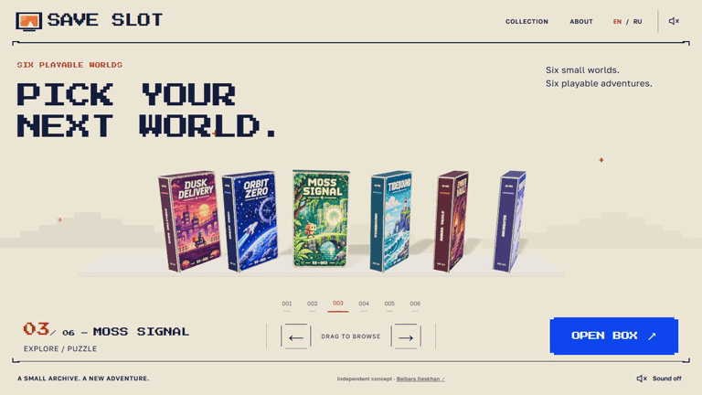
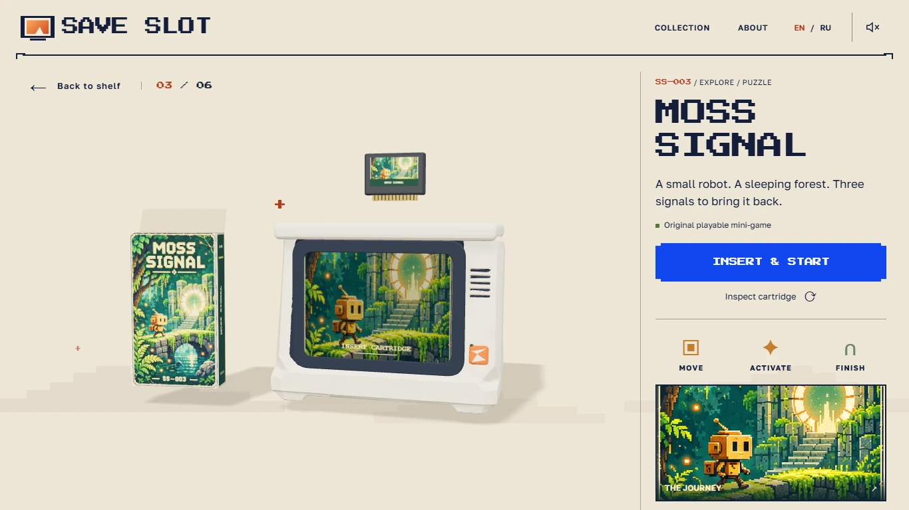
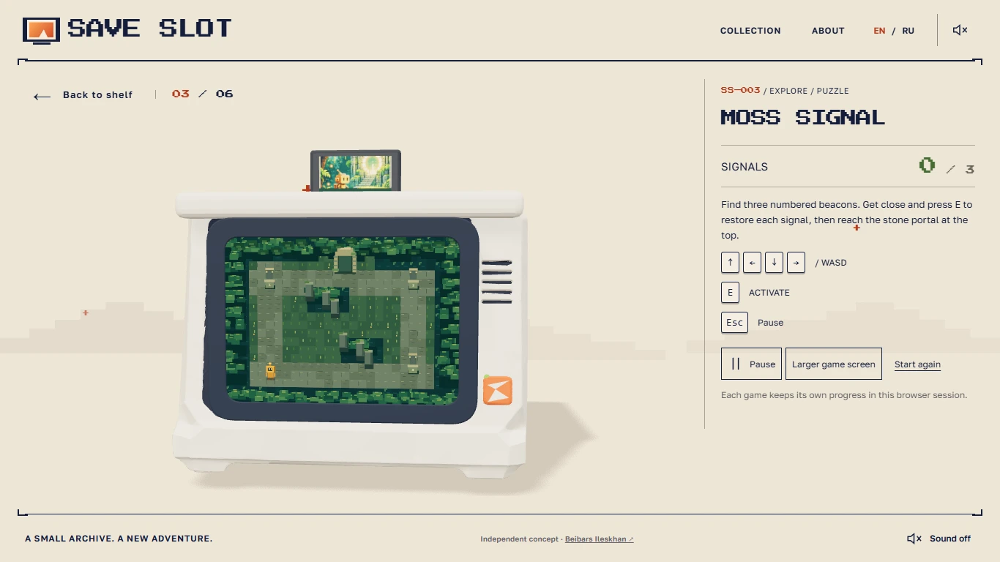
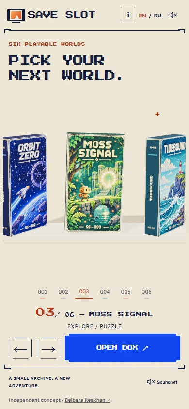
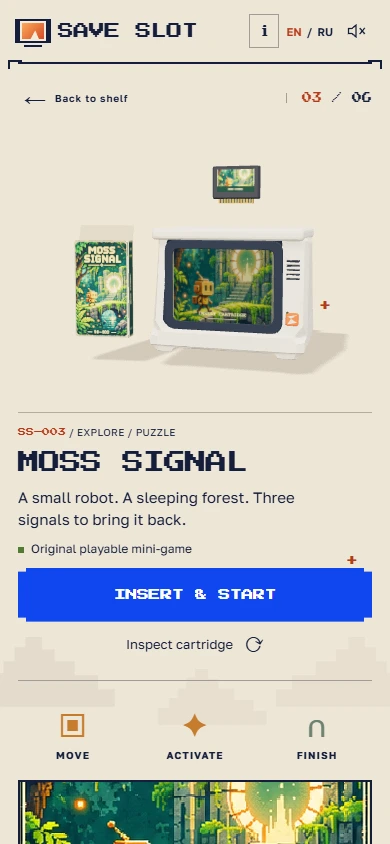
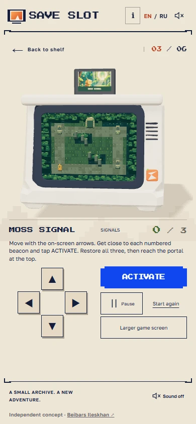
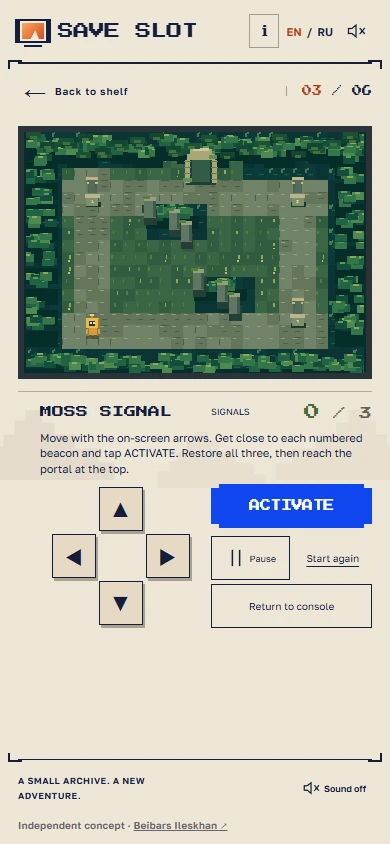

# SAVE SLOT

**Six playable worlds. One shelf.**

A tactile browser experiment by **Beibars Ileskhan**: choose a box, open the flap, insert its cartridge into a retro console, and play. Return to the shelf through the same physical sequence in reverse.

**[Play SAVE SLOT ↗](https://seoshiro.github.io/save-slot/) · [Portfolio ↗](https://seoshiro.github.io/) · [Русский](#русский)**

[](https://seoshiro.github.io/save-slot/)

## From shelf to screen



A 6-second, original-speed excerpt of the public site, reduced to 768 px / 8 fps for GitHub. This is browser footage, not a render or a performance benchmark. [Watch the six-game victory montage](docs/media/six-games-verified.webm) (61 seconds, 3.1 MB). The longer video is an edited selection of actual wins, not one continuous playthrough.

<p>
  
  
</p>
<p>
  
  
</p>
<p>
  
  
</p>

Real screenshots from the current public build. Mobile images use Chromium viewport/touch emulation, not a physical phone. [Capture details](docs/PRESENTATION.md).

## Six cartridges, six mechanics

| World             | What you play                                                                                          |
| ----------------- | ------------------------------------------------------------------------------------------------------ |
| **DUSK DELIVERY** | Deliver three parcels, avoid moving traffic, then return to the depot.                                 |
| **ORBIT ZERO**    | Steer with inertia, collect three energy cells, avoid asteroids and brake to dock.                     |
| **MOSS SIGNAL**   | Explore the forest, activate three nearby beacons, then enter the portal.                              |
| **TIDEBOUND**     | Time crossings through three tidal channels, use islands as checkpoints and reach the lighthouse.      |
| **EMBER VAULT**   | Find a key, activate two seals, cross timed fire traps and open the vault.                             |
| **SNOWBYTE**      | Follow a zigzag ice route with momentum and braking, pass three flags and reach the cable-car station. |

Each game has movement, objectives, hazards or route constraints, a finish state, pause and confirmed restart. The games run on Canvas2D and feed the console screen through a Three.js CanvasTexture. They are playable code, not embedded gameplay videos.

## Controls and continuity

- **Shelf:** drag, click a neighbouring box, use arrows or choose one of six HTML buttons.
- **Keyboard:** arrows / WASD to move, E for the cartridge's action, Escape to pause. Instructions change with the selected game.
- **Touch:** on-screen directional pad and action / brake controls. Pause and restart remain HTML buttons.
- **EN / RU:** interface and game instructions in both languages.
- **Larger game screen:** switch between the console and an enlarged Canvas view, or return directly to the shelf.
- **Saves:** separate progress for each cartridge in the same browser tab/session, including ordinary reload and shelf reentry. These are not cloud saves and are not guaranteed after closing the tab/browser. Blocked storage falls back to page memory until reload or close.
- **Resilience:** reduced-motion support, interruptible transitions, browser-history navigation and a playable light view when WebGL or the console model cannot load.

## How it is built

**React 19 · TypeScript · Vite 8 · Three.js · GSAP · Canvas2D**

One persistent Three.js scene holds the shelf, boxes, cartridges and console. Shared procedural box/cartridge geometry carries six sets of supplied artwork. GSAP coordinates opening, insertion and reverse packing without rebuilding the renderer. HTML carries text and controls; Canvas2D handles all six mini-games. No game engine is required.

This is an independent portfolio concept built with AI assistance. The console source came from **one Meshy 7 Ultra generation through Higgsfield**, followed by Blender cleanup of its shape, cartridge aperture, materials and mesh. The boxes, cartridges, scene assembly, transitions and game logic are built for the browser. The result combines supplied artwork, a generated-and-cleaned console asset and procedural 3D; it is not presented as entirely hand-modelled work.

- [Published console GLB](public/media/console.glb)
- [Model inspection](art/source/console-report.json)
- [Asset provenance](docs/ASSET-CREDITS.md)

No backend, accounts, tracking, payments or external AI calls run in the published site. This is not a commercial game release or client commission. No sales, user metrics or awards are claimed. Project-specific art and models do not imply a general licence grant. Self-hosted fonts retain their upstream OFL licences.

## Run locally

Requires **Node.js 24** and npm.

```sh
npm ci --ignore-scripts
npm run dev
```

Vite serves at `http://127.0.0.1:4197`. To check and build:

```sh
npm test
npm run build
npm run preview
```

The GitHub Pages workflow builds with `/save-slot/` as the base. Hash links select cartridges directly, for example [MOSS SIGNAL](https://seoshiro.github.io/save-slot/#moss-signal). Browser suites use Playwright with installed Chrome; set `TEST_URL` to the preview or public URL. See the audit for the focused gameplay, storage and touch commands.

## Verification and limits

[The six-game audit](docs/ITERATION-2026-11-08-GAMES.md) records all six actual victories, independent saves, partial/completed reload and reentry, restart cancellation/confirmation, and touch input checks. It distinguishes full keyboard routes on the preceding public baseline from fresh full touch routes on application commit `4234d5d`.

The audit reports 60 passing unit tests plus a passing TypeScript/Vite build. Browser evidence uses headless Chrome on Windows, DPR 1, with emulated mobile touch. Physical iOS/Android phones, Safari, Firefox and Edge have not been verified. No universal frame-rate or device-compatibility claim is made.

[QA history](docs/QA.md) · [Current gameplay audit](docs/ITERATION-2026-11-08-GAMES.md) · [Transition and enlarged-return audit](docs/ITERATION-2026-11-08-POLISH.md)

## Русский

**SAVE SLOT: шесть игровых миров на одной полке.** Выберите коробку, откройте её, вставьте картридж в ретроконсоль и играйте. Возврат на полку проходит в обратном порядке. Это самостоятельный портфолио-проект Бейбарса Илесхана, созданный с помощью AI.

Шесть картриджей предлагают разные механики: доставка и движение транспорта, инерционный полёт и стыковка, лесные маяки, приливы, ключ и огненные ловушки, ледяная трасса с торможением. У каждой игры есть цель, завершение, пауза и перезапуск с подтверждением.

- Клавиатура: стрелки / WASD, E для действия, Escape для паузы. На мобильном экране доступны стрелки и кнопка действия или торможения.
- Интерфейс и инструкции переключаются между RU и EN. Игру можно увеличить, затем вернуться к консоли или сразу на полку.
- Прогресс хранится отдельно для каждого картриджа в текущей вкладке/сессии браузера. Это не облачное сохранение. При недоступном хранилище состояние остаётся только в памяти страницы.
- Есть reduced motion и облегчённый игровой режим при ошибке WebGL или загрузки модели.

В основе React, TypeScript, Vite, Three.js, GSAP и Canvas2D. Исходная модель консоли сгенерирована Meshy 7 Ultra через Higgsfield и доработана в Blender. Коробки и картриджи собраны процедурно; анимация и игровая логика работают в браузере.

Все шесть игр пройдены в проверках. Мобильные кадры и проверки выполнены в эмуляции Chromium; физические телефоны и другие браузерные движки не проверялись. Подробности и ограничения приведены в [отчёте](docs/ITERATION-2026-11-08-GAMES.md).

**[Открыть SAVE SLOT ↗](https://seoshiro.github.io/save-slot/) · [Портфолио ↗](https://seoshiro.github.io/)**
